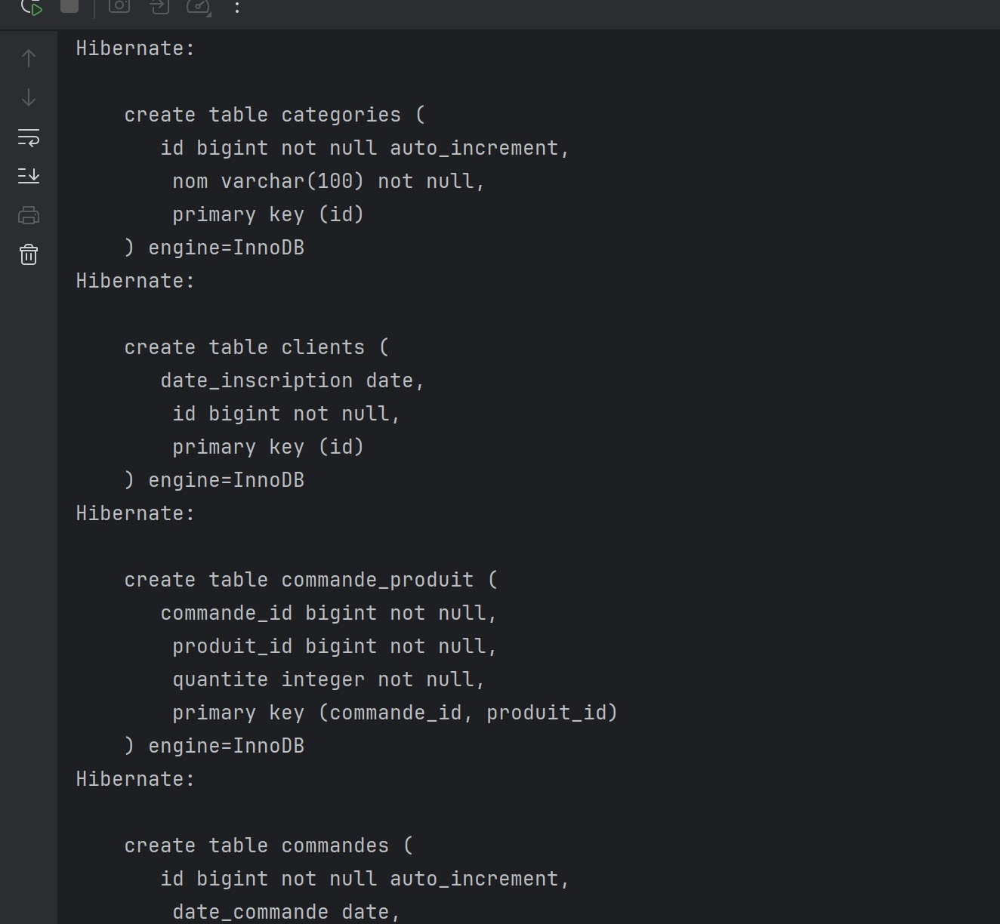
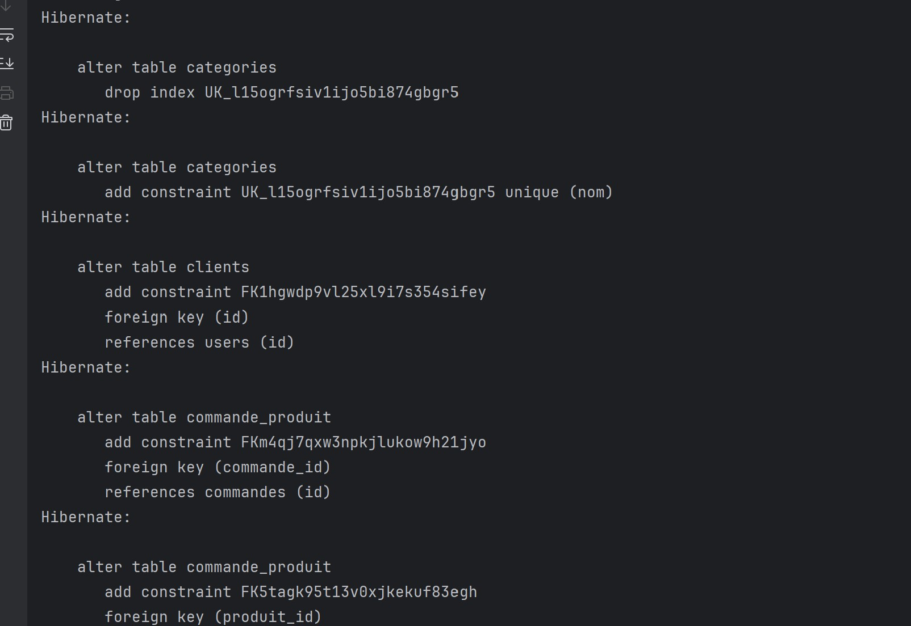
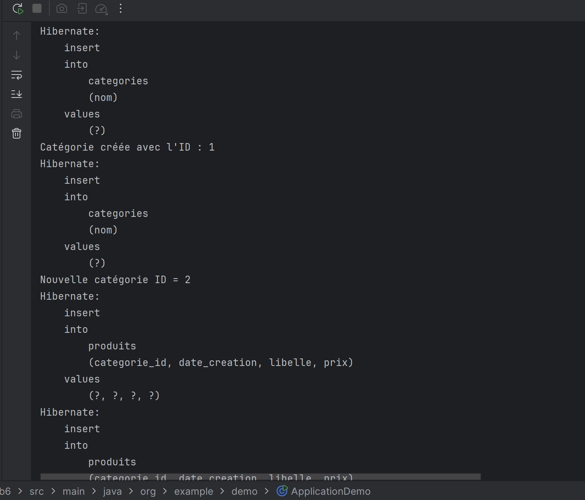
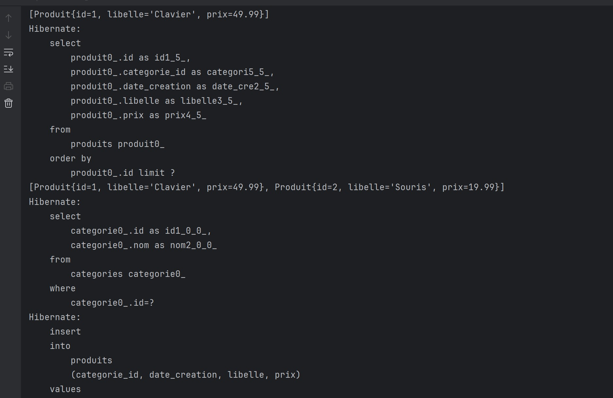
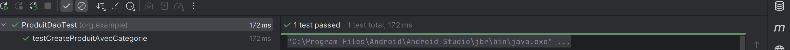
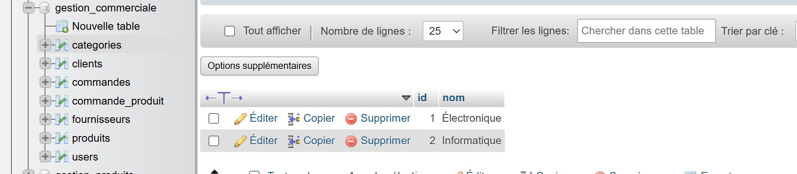

# Lab 6 — Gestion commerciale avec Hibernate

Hibernate crée les tables de la base de données, notamment les catégories, les clients, les commandes et leur association avec les produits.

Hibernate ajoute la contrainte d'unicité sur le nom des catégories et les clés étrangères entre les tables.

L'application enregistre deux catégories avec leurs identifiants générés, puis insère les produits associés.

La console affiche les produits recherchés, la requête de pagination triée par identifiant et l'insertion d'un produit supplémentaire.

Le test JUnit `testCreateProduitAvecCategorie` réussit et valide la création d'un produit associé à une catégorie.

phpMyAdmin affiche les tables de la base `gestion_commerciale` et les catégories « Électronique » et « Informatique » enregistrées avec les identifiants 1 et 2.
